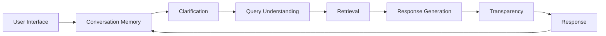

# RAG Multi-Agent Knowledge Assistant

Local retrieval-augmented knowledge assistant with document ingestion, semantic search, grounded response generation, multi-turn clarification, conversation memory, browser voice controls, and response transparency.

## Project Overview

The assistant accepts questions through a FastAPI service and browser client. Documents are extracted, cleaned, chunked, embedded, and indexed in FAISS. A deterministic multi-agent pipeline classifies each query, resolves conversational context, retrieves evidence, generates an evidence-grounded response, and reports the sources and confidence state used for that response.

The system is designed for local demonstration and evaluation. It does not provide authentication, multi-user authorization, or a hosted persistence layer.

## Milestone Status

| Milestone | Status | Scope |
|---|---|---|
| M1 | **Partial** | Ingestion, cleaning, chunking, embeddings, FAISS storage, semantic retrieval, and API foundation; unavailable-query false positive remains |
| M2 | **Blocked** | Query understanding, retrieval and orchestration are implemented; real-provider answer grounding is unverified and one unavailable query retrieved misleading evidence |
| M3 | **Partial** | Clarification, bounded in-process memory, context resolution, voice controls, and transparency are implemented; real device/provider acceptance remains incomplete |

**Release gate: M1–M3 NOT COMPLETE. Do not start Milestone 4.** See the [release audit](docs/m1-m3-release-audit.md) for the pre-fix traceability matrix, post-fix evidence, and remaining blockers.

## Milestone 1 Capabilities

- PDF, DOCX, TXT, and CSV extraction
- Text cleaning and paragraph-aware chunking with `tiktoken`
- `all-MiniLM-L6-v2` embeddings and FAISS `IndexFlatL2` search
- Ranked semantic Top-K retrieval with document and chunk provenance
- Duplicate-source protection during indexing
- Sample-corpus generation and provenance-gated retrieval evaluation
- FastAPI health, upload, and retrieval endpoints

## Milestone 2 Capabilities

### Query Understanding

`QueryUnderstandingAgent` is deterministic and classifies requests as:

- `factual`
- `procedural`
- `comparative`
- `ambiguous`

It returns the normalized query, routing decision, domain, classification confidence, and reason. Classification confidence is an application-level signal, not a calibrated probability.

### Retrieval

`RetrievalAgent` calls the FAISS-backed retriever once per normal request, ranks by L2 distance, derives bounded relevance as `1 / (1 + distance_score)`, applies the configured relevance threshold, and preserves source, chunk, text, and metadata fields.

### Response Generation

`ResponseGenerationAgent` uses the optional configured OpenAI client. Its grounding prompt treats retrieved passages as untrusted evidence, prohibits outside facts and invented citations, and returns a controlled no-information response when evidence is missing or weak.

### Orchestration

Normal M2 flow:

```text
Query Understanding → Retrieval → Response Generation → Response
```

Ambiguous requests stop before retrieval and return a structured clarification response.

## Milestone 3 Capabilities

- **Clarification Agent**: detects incomplete, vague, multi-part, unresolved-reference, and ambiguous-terminology requests; stores a clarification state and resumes the original intent after an answer.
- **Conversation Memory Agent**: keeps bounded per-session history, supports relevant context selection, tracks pending clarifications, and limits in-process sessions.
- **Context Resolution**: resolves pronouns, topic continuations, and numbered references when suitable context exists; otherwise routes the request to clarification.
- **Web Speech API voice input**: browser speech recognition produces editable transcript text. The transcript is sent through the normal `/chat` endpoint only after the user submits it.
- **Web Speech API Text-to-Speech**: assistant responses can be played, paused, resumed, and stopped in the browser.
- **Response Transparency Panel**: displays confidence state, grounding state, source names, chunk IDs, relevance values, excerpts, and no-result explanations from the existing response payload.
- **M3 API lifecycle**: session history and deletion endpoints support the browser conversation UI.

## M3 Architecture



Clarification requests return after the Clarification stage. They do not call retrieval or response generation until the user supplies the clarification answer.

## Technology Stack

| Layer | Technology |
|---|---|
| Language | Python 3.11 |
| API | FastAPI, Uvicorn, Pydantic |
| Document extraction | PyMuPDF, python-docx, pandas |
| Chunking | `tiktoken` with `cl100k_base` |
| Embeddings | `sentence-transformers` with `all-MiniLM-L6-v2` |
| Vector search | `faiss-cpu`, `IndexFlatL2` |
| Metadata | JSON |
| Optional generation | OpenAI Chat Completions API, default model `gpt-4o-mini` |
| Browser voice | Web Speech API: `SpeechRecognition` and `speechSynthesis` |
| Frontend | HTML, CSS, and browser JavaScript |

## Project Structure

```text
rag-multi-agent-knowledge-assistant/
├── app.py                         # FastAPI API and static frontend hosting
├── agents/                        # M2/M3 agents and shared models
│   ├── clarification.py
│   ├── context_resolution.py
│   ├── memory.py
│   ├── orchestrator.py
│   ├── query_understanding.py
│   ├── response_generation.py
│   ├── retrieval_agent.py
│   └── transparency.py
├── ingestion/                     # Extraction, cleaning, chunking, validation
├── retrieval/                     # Semantic retriever adapter
├── vector_store/                  # Embeddings and FAISS persistence
├── frontend/
│   ├── index.html
│   ├── css/
│   └── js/                        # Chat, API, voice, speech, transparency UI
├── data/                          # Indexed data, uploads, and metadata
├── architecture/                 # System and pipeline diagrams
├── docs/                          # Research, validation, and decisions
├── evaluation/                   # Retrieval and M2 evaluation scripts/results
├── test_*.py                     # M1, M2, and M3 tests
└── requirements.txt
```

## Setup

From the repository directory:

```powershell
python -m venv .venv
.\.venv\Scripts\Activate.ps1
python -m pip install -r requirements.txt
```

Optional LLM configuration can be provided through environment variables:

```powershell
$env:OPENAI_API_KEY = "your-key"
$env:OPENAI_MODEL = "gpt-4o-mini"
```

Without an OpenAI key, the response agent uses its controlled no-information behavior when generation is required.

## Running the Backend

From `rag-multi-agent-knowledge-assistant/`:

```powershell
uvicorn app:app --reload
```

The API and browser frontend are served at `http://localhost:8000`. Interactive API documentation is available at `http://localhost:8000/docs`.

The evaluation corpus generator creates synthetic sample documents for test and
development use; those documents are not production-source evidence. The M1.4
acceptance evaluator labels every query and source by provenance and reports
BLOCKED until verified original sources and complete coverage are registered.
Run the evaluator with:

```powershell
python -m evaluation.m14_provenance
```

To prepare the generated sample corpus for local retrieval diagnostics only:

```powershell
python generate_evaluation_corpus.py
python index_evaluation_corpus.py
```

Generated-sample retrieval results do not count toward M1.4 acceptance. See
[`evaluation/m14_provenance_results.md`](evaluation/m14_provenance_results.md)
for the current provenance-gated report.

## Running the Frontend

The backend serves the existing frontend automatically. Start Uvicorn, then open:

```text
http://localhost:8000/
```

There is no separate frontend build or package installation. Microphone and speech-synthesis behavior depends on browser permissions and Web Speech API support.

## API Endpoints

| Method | Endpoint | Purpose |
|---|---|---|
| `GET` | `/health` | Liveness check |
| `GET` | `/ready` | Readiness and vector-store check |
| `POST` | `/upload` | Ingest and index a PDF, DOCX, TXT, or CSV file |
| `POST` | `/retrieve` | Run the retrieval-oriented assistant pipeline |
| `POST` | `/chat` | Run the M3 chat pipeline with session and clarification state |
| `GET` | `/sessions/{session_id}/history` | Read bounded in-process session history |
| `DELETE` | `/sessions/{session_id}` | Clear a session |

### Chat Request

```json
{
  "query": "What is the primary role of the Query Understanding Agent?",
  "top_k": 3,
  "session_id": "optional-session-id",
  "clarification_id": null
}
```

### Example Response

```json
{
  "status": "answered",
  "answer": "The Query Understanding Agent classifies user intent.",
  "confidence": 0.82,
  "confidence_level": "HIGH",
  "no_information_found": false,
  "citations": [
    {
      "chunk_id": "chunk-17",
      "filename": "architecture/rag-query-flow.md",
      "excerpt": "...",
      "document_id": "document-1"
    }
  ],
  "m3": {
    "memory": {"used_context": false},
    "transparency": {
      "retrieved_count": 1,
      "grounded": true,
      "source_evidence": [
        {"document_name": "architecture/rag-query-flow.md", "chunk_id": "chunk-17", "similarity_score": 0.82}
      ]
    }
  }
}
```

## M3 Test Scenarios

The scenario suite covers:

1. Normal factual query through the complete pipeline
2. Ambiguity stopping before retrieval
3. Clarification continuation and refined query construction
4. Follow-up context resolution
5. Pronoun resolution
6. Topic switching without prior-topic contamination
7. Missing context producing clarification
8. Speech transcript to editable input to `/chat` flow at the frontend boundary
9. TTS play, pause, resume, and stop controls at the frontend boundary
10. Transparency source names, chunk IDs, scores, citations, and confidence
11. No-result transparency behavior
12. Low-confidence non-authoritative behavior

Run the complete suite:

```powershell
python -m pytest -q
```

Latest complete-suite evidence is recorded in the [release audit](docs/m1-m3-release-audit.md); evaluation-index data is generated in an isolated copy for release checks.

## Known Limitations

- Conversation memory is currently in-process. It is lost on restart, is not shared across workers, and is not a durable multi-user store.
- Session IDs are client-supplied identifiers; the local demonstration does not provide authentication or session ownership authorization.
- Browser support and permission policy affect Web Speech API speech recognition and Text-to-Speech behavior.
- Retrieval similarity is not necessarily calibrated probability. FAISS L2 distance is transformed into a bounded application relevance value for thresholding and reporting.
- The two-domain retrieval evaluation still has one unavailable hospital-revenue query whose nearest neighbor is the admission policy; a relevant-looking neighbor is not proof of answer support.
- Uploaded documents infer one of the two supported retrieval domains from extracted text. Unknown or mixed-domain documents can remain unclassified and are not domain-filtered.
- The confidence indicator methodology is application-level: `HIGH` is at least `0.75`, `MEDIUM` is `0.45` to below `0.75`, and `LOW` is below `0.45`.
- Knowledge-base evidence and conversation memory are separate. Memory resolves conversational references; it is not treated as knowledge-base evidence or cited as a document source.
- The optional LLM provider is not configured in this environment. Mock-provider tests validate response contracts and citation mapping, not factual accuracy or semantic entailment.
- Real microphone permission and native browser speech synthesis were not exercised; deterministic Web Speech stubs cover the browser controls.

## M3 Implemented Scope (Not a Release Approval)

- [x] Clarification Agent detects ambiguity and persists clarification state
- [x] Clarification continuation resumes the normal pipeline
- [x] Conversation Memory Agent provides bounded session context
- [x] Pronoun, continuation, numbered-reference, and topic-switch handling implemented
- [x] Normal, clarification, follow-up, no-result, and low-confidence flows tested
- [x] Transparency reports retrieval evidence, citations, stages, and confidence state
- [x] Browser Web Speech API voice input wired to editable text input
- [x] Browser Web Speech API Text-to-Speech play/pause/resume/stop controls wired
- [x] API history and session deletion endpoints implemented
- [x] Complete Python suite passes in the current workspace
- [ ] Real-provider grounded answer validation
- [ ] No false-positive evidence for unavailable queries
- [ ] Native microphone permission and speech checks

## Documentation

| File | Contents |
|---|---|
| [`architecture/system-architecture.md`](architecture/system-architecture.md) | System architecture |
| [`architecture/multi-agent-orchestration.md`](architecture/multi-agent-orchestration.md) | Agent orchestration |
| [`architecture/rag-query-flow.md`](architecture/rag-query-flow.md) | Query and retrieval flow |
| [`docs/architecture.md`](docs/architecture.md) | Architecture notes |
| [`docs/validation.md`](docs/validation.md) | Validation notes |
| [`docs/m1-m3-release-audit.md`](docs/m1-m3-release-audit.md) | Current M1–M3 release gate and audit evidence |
| [`evaluation/m2_end_to_end_results.md`](evaluation/m2_end_to_end_results.md) | M2 evaluation results |