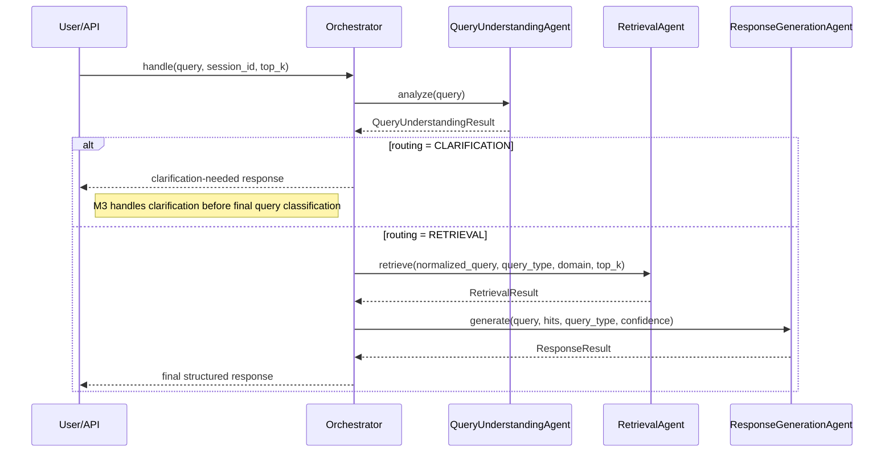
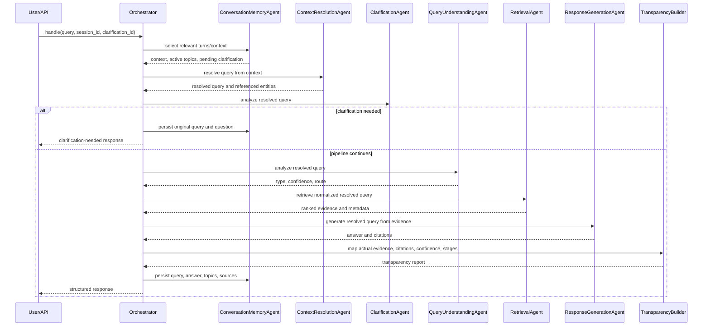

# Multi-Agent Orchestration — M1–M3 As Built

The implementation is a fixed sequential pipeline of plain Python classes. It
does not use LangChain, LangGraph, autonomous planning, or agent-to-agent
negotiation.

## M2 retrieval/generation sub-sequence

This is the retrieval/generation sub-sequence after context resolution and
clarification. The full request begins with per-session memory, resolves context,
and evaluates the resolved request for clarification before the final Query
Understanding classification.

## Full M3 request lifecycle

Clarification answers resume from the stored original request and continue
through Query Understanding, Retrieval, Response Generation, and Transparency.
Every completed response carries a generated `request_id`.

## M2.1 Query understanding

The rule-based classifier returns exactly:

- `factual`
- `procedural`
- `comparative`
- `ambiguous`

It also returns deterministic application-level classification confidence,
detected domain, reason, and routing. Factual/procedural/comparative route to
retrieval. Ambiguous routes to clarification. Unavailable information is not an
intent; retrieval evidence determines availability.

## M2.2 Retrieval handoff

`RetrievalResult` contains the normalized query type, requested Top-K, ranked
`RetrievalHit` values, filtered count, retrieval confidence, evidence sufficiency,
and no-relevant-information state. Each hit preserves text, filename, document ID,
chunk ID, metadata, L2 distance, and derived relevance.

FAISS L2 distance is lower-is-better. The application relevance representation is
`1 / (1 + distance_score)`.

## M2.3 Response handoff

`ResponseGenerationAgent` receives retrieved hits and retrieval confidence. When
an LLM provider is configured, its prompt requires context-only answers, no
outside knowledge, explicit insufficient evidence, and citations only from
retrieved metadata. Missing or low evidence returns a controlled response.

Confidence levels are application-level labels:

- `HIGH`: confidence >= 0.75
- `MEDIUM`: 0.45 <= confidence < 0.75
- `LOW`: confidence < 0.45

They are not calibrated probabilities.

## Error handling

Classification, retrieval, generation, and malformed-output failures return a
structured `AgentError` with the failing agent, code, and message. The API maps
these failures to HTTP 500 responses.

## Beyond M3

Hybrid retrieval, reranking, persistent sessions, autonomous planning, and
agent-to-agent negotiation are future work.
