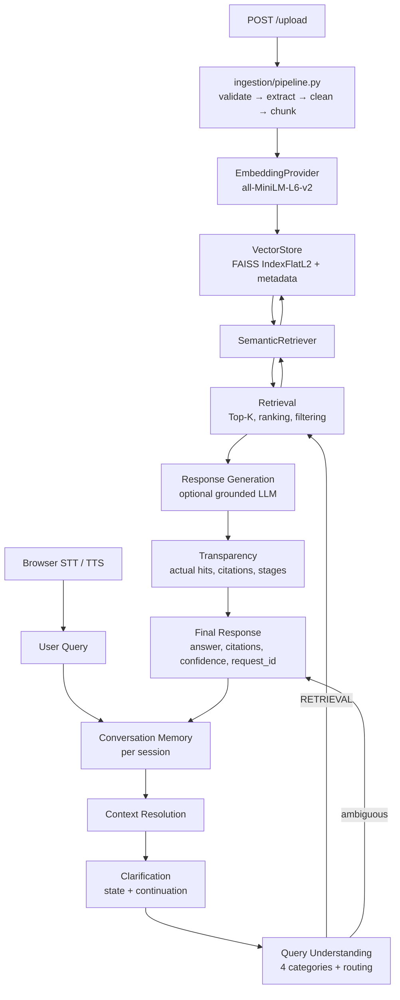

# System Architecture — M1–M3 As Built

M1 provides multi-format ingestion, local embeddings, FAISS storage, and retrieval.
M2 adds deterministic query understanding and evidence-grounded response
generation. M3 adds clarification lifecycle, session memory, contextual query
resolution, browser voice controls, and evidence transparency. OpenAI generation
is optional and requires `OPENAI_API_KEY`; STT/TTS run in the browser.

## Implemented: M1 + M2 + M3



### Query path

```text
User Query → Memory → Context Resolution → Clarification → Query Understanding
           → Retrieval → Response Generation → Transparency → Final Response → Memory
```

Unresolved or incomplete queries return after clarification and do not retrieve
until the user responds. The clarified request resumes through classification,
retrieval, generation, and transparency. `/retrieve` and `/chat` both use this
orchestrator; `/retrieve` remains for backward compatibility.

The orchestrator is fixed-sequence Python code, not autonomous planning, tool
selection, or agent-to-agent negotiation.

## API

| Endpoint | Implemented behavior |
|---|---|
| `GET /health` | Liveness response |
| `GET /ready` | Nonempty FAISS index/metadata readiness |
| `POST /upload` | Full ingestion pipeline and FAISS/metadata persistence |
| `GET /documents` | Grouped indexed-document metadata |
| `POST /retrieve` | Backward-compatible orchestrator route |
| `POST /chat` | Clarification-aware M3 orchestrator |
| `GET /sessions/{id}/history` | In-process conversation history |
| `DELETE /sessions/{id}` | Clear session memory |

`POST /retrieve` returns query type, classification confidence, answer, confidence
level, citations, retrieval summary/results, no-information state, clarification
state, and request ID. Internal API keys and provider objects are not exposed.

## Beyond M3

- Hybrid sparse+dense retrieval and cross-encoder reranking
- Managed vector databases and deployment infrastructure
- Persistent or multi-user session storage and authentication
